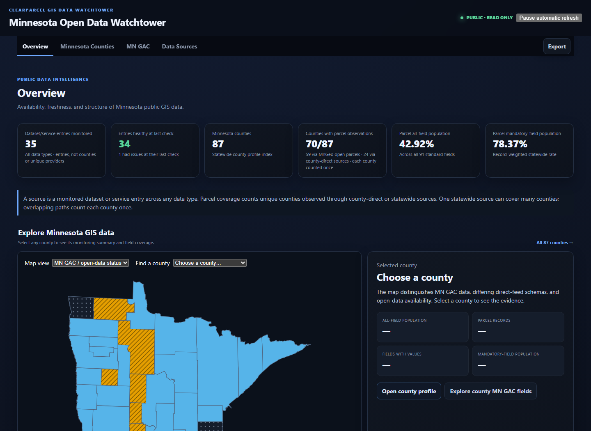
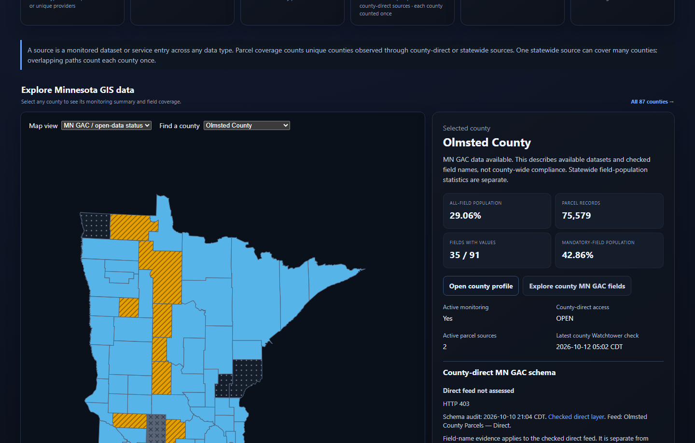

# GIS Data Watchtower

**Explore the availability, freshness, and field population of Minnesota public GIS data.**

**[Explore the live public dashboard](https://gis-watchtower.clear-parcel.com/)** · **[User guide](docs/user-guide.md)** · **[Documentation index](docs/README.md)**

The current production dashboard release is **v0.3.1**, deployed October 20, 2026. See
[STATUS.md](STATUS.md) for what is deployed and what is in review, and the
[v0.3.1 release record](docs/release-v0.3.1.md) for bounded verification,
remaining acceptance gaps and rollback evidence. The dashboard rollback baseline
is v0.3.0; provider and publisher jobs remain on v0.3.0.

The private GAC selection fix is a local candidate requiring a migrated hosted
wrapper in the next release; see the [implementation handoff](docs/ai/handoffs/2026-10-20-private-gac-selector.md).

Operators can use the [offline triage runbook](docs/operations-triage.md) to
review saved provider-run evidence without triggering new checks or notifications.
The [authority reconciliation runbook](docs/monitoring-authority-reconciliation.md)
checks supplied monitoring-approval evidence without activating sources.
The [isolated restore rehearsal](docs/isolated-restore-rehearsal.md) exercises
synthetic aggregate recovery and concurrent publishing in temporary local storage.

*Actual public dashboard, captured October 12, 2026. Counts, check times, and field-population percentages change as new observations arrive.*

## What is Watchtower?

GIS Data Watchtower is an open-source Python monitoring and reporting application maintained by **ClearParcel**. Its public website—**Minnesota Open Data Watchtower**—helps county staff, GIS professionals, researchers, and residents understand where Minnesota public geospatial data is available and what the latest recorded checks show.

It monitors selected public ArcGIS, WMS/WFS, and other supported GIS services, records changes and data-quality signals, and publishes a **sanitized, read-only** dashboard. It is **not** a property-ownership search, a complete inventory of every GIS service, an official source-data repository, or a certification of a county's compliance with a data standard.

### What you can explore

| Public view | What it helps answer |
| --- | --- |
| **Overview** | How many service entries are monitored? Which had warnings? How many Minnesota counties have parcel observations? |
| **Minnesota Counties** | What access, statewide availability, county contacts, and monitoring evidence are recorded for a county? |
| **MN GAC** | How frequently are standard parcel, address-point, and road-centerline fields populated in available statewide data? |
| **Data Sources** | Which public GIS sources are checked, and what were their latest recorded statuses and observation times? |
| **Exports** | How can I reuse published summary evidence as JSON, CSV, or Excel without downloading private operational data or raw parcel-owner records? |

**Four distinctions matter:**

- **Field population is not a compliance grade.** A blank Conditional, If Available, or Optional field can be valid. Mandatory-field and all-field statistics answer different questions.
- **No data does not mean zero.** A county absent from a particular statewide open layer is not automatically missing data at the county level or failing a standard.
- **County scan labels use the saved observation.** Shared source-schema metadata accompanies county-specific measurements; a measured zero remains scanned, while an unscanned or unavailable result is not assigned a population percentage. See [county field interpretation](docs/mngac-completeness.md#county-schema-and-scan-labels).
- **Access, monitoring, and publication are different.** A county may publish data directly, appear in MnGeo's opt-in statewide compilation, be observed through either or both paths, or await access-policy clarification.

See the [illustrated public user guide](docs/user-guide.md) for step-by-step instructions and examples.

## Explore a county

1. Open the **[public dashboard](https://gis-watchtower.clear-parcel.com/)**.
2. On **Overview**, select a county on the map or with **Find a county**. The adjacent panel provides recorded monitoring and field-population details.
3. Select **Open county profile** for source, contact, and access evidence, or **Explore county MN GAC fields** for field-by-field results.
4. Use **MN GAC** to switch between **Parcels**, **Address Points**, and **Road Centerlines** and compare counties.
5. Use **Export** or page-specific export controls to obtain a dated, reusable summary.

*Illustrative county selection as of October 12, 2026. Direct-feed observations are not county-wide compliance findings.*

## Data, freshness, and responsible use

- Watchtower separates **source health**, **provider check freshness**, and **public snapshot publication freshness**. A recently published page does not necessarily mean an external provider was just checked.
- The approved cloud provider checks run **daily at 5:00 a.m. America/Chicago**. A separate sanitized public publisher runs every **10 minutes**. Always consult observation timestamps.
- The public site exposes derived counts, field population, statuses, and attribution—not parcel-owner records, private credentials, operational provider endpoints, or diagnostic fingerprints.
- The system uses bounded, respectful requests. It does not scrape human-facing property-search websites or bypass provider access restrictions. Public reachability does not grant redistribution rights.

Read the [MN GAC methodology](docs/gac-standards.md), [county access methodology](docs/county-parcel-data-access-audit.md), [provider-use guidance](docs/data-watchtower-provider-compliance.md), and [public/private design](docs/public-dashboard-hosting.md).

## Install and run your own monitor

Requires **Python 3.12 or later**:

~~~bash
python -m venv .venv
# Activate .venv for your platform, then:
python -m pip install -e .
~~~

For optional Google Cloud Storage support:

~~~bash
python -m pip install -e ".[gcs]"
~~~

The included **config/example_sources.json** is intentionally provider-neutral. Configure only services you are authorized to monitor. See the [configuration reference](docs/configuration.md) for sources, storage, request limits, authentication, and environment variables.

~~~bash
watchtower --config config/example_sources.json check
watchtower --config config/example_sources.json status
watchtower --config config/example_sources.json dashboard --host 127.0.0.1 --port 8765
~~~

A local dashboard defaults to private/loopback access; Internet-facing deployments require appropriate authentication and TLS controls. The hosted public view is a separate read-only presentation of sanitized data, not the private operational dashboard.

Developers can use the [documentation index](docs/README.md), [contribution guidelines](CONTRIBUTING.md), and [cloud/offline development guide](docs/codex-cloud-development.md). CI covers Windows and Ubuntu, Python 3.12–3.14, container smoke tests, dependency auditing, CodeQL, and image scanning.

## Releases and project status

**GIS Data Watchtower v0.3.0 is live**, deployed October 14, 2026, from
merged source `4e4dbec`. It ships the 2026-10-13 review stack: provider
compliance at run time, shared-state guards, public accuracy, mobile and
accessibility work, engine hardening, and a script-hash Content-Security-Policy.
The previous v0.2.3 release added the supplied Watchtower logo beside the
public header title and the supplied favicon.
The footer displays only the version number; the About section explains
the open-source ClearParcel mission, disclaimer, and GitHub link.

- **[Current production release and rollback evidence](docs/release-v0.3.0.md)** — v0.3.0 images, revisions, and acceptance
- **[v0.2.3 release](docs/release-v0.2.3.md)** — rollback baseline
- **[Validated operational status](STATUS.md)** — current monitoring and remaining gates
- **[GitHub releases](https://github.com/clearparcel/GIS-Data-Watchtower/releases)** — versioned summaries
- **[Documentation index](docs/README.md)** — user guides, methodology, engineering references and dated history
- **[Original v0.2.0 release](docs/archive/release-v0.2.0.md)** and
  **[October 11 correction](docs/archive/release-county-percentage-fix-2026-10-11.md)** — retained history

Earlier merged PR #69 static-output/provider retry corrections also ship in
the v0.2.2 application image. The coordinated v0.2.2 release updated both
dashboard services and the existing provider/publisher job images without
changing source registries, security settings, or schedules.

The v0.3.0 rollout updated both dashboard services and the provider and public-publisher job images. Monitoring schedules, source registries and security boundaries were preserved. The v0.2.3 rollout had updated only the dashboard services, so v0.2.2 is the job rollback baseline.

This is a **pre-1.0** project. Open issues may represent documented
provider-policy, privacy, and observation gates rather than defects.

## Contribute, ask questions, and report problems

Contributions and corrections are welcome. Use [GitHub Issues](https://github.com/clearparcel/GIS-Data-Watchtower/issues/new/choose) for reproducible bugs, public-data corrections, and enhancements, and follow [CONTRIBUTING.md](CONTRIBUTING.md).

**Do not report vulnerabilities in public issues.** Follow the private reporting process in [SECURITY.md](SECURITY.md).

GIS Data Watchtower is licensed under the **[MIT License](LICENSE)**. Source agencies remain authoritative for their own datasets, definitions, release policies, and attribution requirements.
