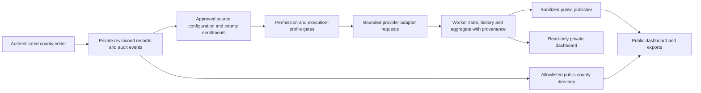

# November 8 review disposition — v0.5.1

Base: `8661beaf65a0017d2c47c97d300fa535567d76d5`. This records the response to the
repository review; it is not a claim that every operational backlog item has
been completed. See the release record for actual promotion state.

| Finding | Correction / disposition |
| --- | --- |
| R01 High: enrolled-source SSRF | Incorporates PR #230, including DNS validation, address pinning, proxy rejection and all shared transports. |
| R02 Medium: corrupt private sync | Validate aggregate structure/totals and history containers before replacement; preserve good files, show cached-data warning and expose authenticated `/healthz` sync failure. |
| R03 Medium: directory outages | Back off failed reads for at least five seconds; all directory CSV exports return controlled 503; public readiness includes directory availability. |
| R04 Medium: storage amplification | 30-second editor summary cache with successful-save invalidation; bounded 2,052-byte attachment metadata reads tied to a storage generation. Cold lists still read 87 county records; no unbounded parallel fan-out was introduced. |
| R05 Medium: LAN authentication | Password-free access is loopback-only; existing read-only hosted IAP trust is preserved. |
| R06 Medium: save attribution | Verified actor, time and revisions are committed atomically with each private save; replay creates no duplicate event. Retention and private retrieval are documented. |
| R07 Low: repeated research validation | Cache a private research snapshot/digest for the immutable application process; freshness buckets remain independent. |
| R08 Low: stale current claims | Remove conflicting current-release summaries; source-version/doc consistency is checked; label backup history by date and retain scanner acceptance evidence. |
| R09 Low: contributor dependencies | Document constrained full-extra installation and Node 24; optional scanner transport test skips when its dependency is absent. |
| R10 Low: stale work | Disposition below preserves unique work and separates obsolete releases from unfinished features. |
| R11 Low: personal checkout | Replace current public machine/account mapping with a role and private inventory; remove the hygiene-test exemption. No public history rewrite. |
| R12 Low: concentrated modules | Consolidate the identical timestamp parser, preserving legacy aliases. Broad adapter/editor decomposition is deliberately incremental; it is a maintenance backlog, not a demonstrated runtime defect. Compatibility shims and historical evidence remain intentional. |

## Branch/PR disposition

Six obsolete branch refs were retired only after their exact tips were preserved
as `archive/2026-11-08/<original-branch>` tags. Unique history is retained.
Commit permalinks and existing PRs also preserve the original evidence.

- **PR #230**: incorporated by ancestry in v0.5.1; GitHub marked it merged with PR #231.
- **PR #209 / `codex/washington-parcel-release`**: obsolete v0.3.14 packaging;
  closed as superseded; the original branch tip is archived. Washington's fees/license
  conflict remains a terms hold. This release does not enroll it or poll it.
- **PR #213 / `codex/watchtower-v040-live-verification`**: historical live
  acceptance retained in `docs/release-v0.4.0.md` from
  `fc12973f9c6d6e62a2610aac08d03b3f87e0be0a`; the superseded draft is closed and its branch tip archived.
- **PR #143 / `claude/county-data-fees`**: preserve as explicitly deferred feature
  work at `89c59792bfb6797de47d10220f91ef18f67e10fd`. It needs a current county-editor
  integration design and refreshed citations before rebase. Shipping a new fees
  dataset is outside this security/maintenance patch; do not merge its old UI.
- **`codex/status-handoff-20261020`**: retire the historical continuation lane.
  Unique evidence stays at [its exact commit](https://github.com/clearparcel/GIS-Data-Watchtower/commit/7e0890c2951d1ae585a23202568c77883fced73f).
- **`feat/data-freshness`**: superseded by PR #197 and later history/MnGeo fixes.
  Its [original commit](https://github.com/clearparcel/GIS-Data-Watchtower/commit/a840a7c7244e2ef3e4f26513ded3b58f6557fe41)
  stays available; do not merge the older implementation over main.
- **Research branches**: preserve both documents in `docs/research/`, explicitly
  historical. Original heads: credential research `a767ab564e3b83b9d12c3f7baa73303f406f6021`;
  retention research `6e083b28b654e6bd6519f6fa4e8d117be69861a0`. Their operational
  proposals remain subject to issues #189–#191 and current owner decisions.
- **Dependabot branches**: recent automated work, not classified stale. Keep
  normal dependency review/CI; no blanket deletion or unsolicited dependency bump.

## Remaining operational and maintenance scope

The previously owner-deferred independent backup/project separation (#181/#205),
independent heartbeat (#202), and future drafting-credential governance (#191)
remain tracked decisions. No new credential, backup project, irreversible
retention lock or provider schedule is created by this patch. Historical accepted
public release evidence and intentional professional county contact data are
retained. Large-module extraction should proceed behind stable interfaces with
adapter and editor recovery tests, rather than combining a wholesale rewrite
with this patch release.

## Architecture and principal data flow

| Layer | Responsibility |
| --- | --- |
| Entry points | `cli.py` selects checks, worker jobs, publishing and servers. Separate public, private and county-editor HTTP handlers enforce their respective read-only, Basic-auth or IAP boundaries. |
| Domain/orchestration | `watch.py` validates sources and execution profiles, applies county permission/terms gates, runs bounded adapters and records health, history and telemetry. County editing uses revisioned saves and separate enrollment/publication operations. |
| Transport and storage | Deadline-bound urllib/curl requests preserve TLS, redirect limits and per-host 429 backoff. Local files or GCS use conditional writes for shared state. Attachment bytes remain quarantined until a trusted scanner verdict. |
| Projection and presentation | Aggregation preserves worker provenance and freshness. The publisher removes private fields; public HTML/JSON/CSV/XLSX/PDF consume sanitized observations and the separately published county directory. The operational dashboard reads private state. |
| Deployment | Cloud Run services/jobs, Cloud Scheduler, GCS, Secret Manager and IAP supply the operational runtime. GitHub Actions runs the cross-platform test/security matrix. |

Key dependencies are Python 3.12+, urllib/curl and the supported GIS/provider
APIs; Google Cloud Storage/Auth for hosted persistence; reportlab for PDFs;
ClamAV for private attachment scanning; IAP for hosted access; and the private
provider-terms CRM for the internal terms view. Node 24 is a test prerequisite,
not an application-server requirement. The full contributor environment also
uses pypdf for PDF assertions. Runtime dependencies are constrained in
`constraints.txt`; CI additionally scans the container OS packages.

Remaining scaling considerations: cold editor lists still read 87 records;
large aggregate/history files are downloaded on refresh; provider runs are
bounded and intentionally low frequency; public PDF rendering has a two-slot
limit. The new caches and header reads address the reproduced avoidable work
without introducing unbounded concurrency or increasing provider traffic.

## Five-step safe local checklist

1. Clone a reviewed revision into an isolated checkout, read `AGENTS.md`, and
   preserve unrelated work. Use Python 3.12+ and Node 24. Do not import production
   credentials, registries or operational state.
2. Create/activate a virtual environment, install with
   `python -m pip install -c constraints.txt -e '.[gcs,pdf,pdf-test]'`, and run
   `python -m pip check`.
3. Set `WATCHTOWER_REQUIRE_NODE=1`; run the ResourceWarning-strict unittest suite,
   compileall, `python scripts/sync_current_status.py --check` and
   `git diff --check` as listed in `CONTRIBUTING.md`.
4. Generate synthetic fixtures with `python scripts/prepare_cloud_development.py`,
   then run `bash scripts/preview_cloud_dashboard.sh` from the activated environment.
   Keep the server on loopback. On Windows, use the documented equivalent CLI
   with the generated local fixture and explicitly selected local storage.
5. Check synthetic source/worker freshness and exports, stop the preview, and
   inspect Git status before committing. Do not run `check`, `cloud-job` or
   `public-publish` against operational settings as a local smoke test; Docker's
   default command is a worker, so override it with `--help` for container smoke.
