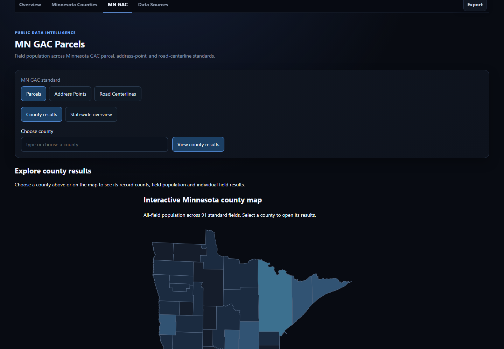

# Minnesota Open Data Watchtower — public user guide

**Live dashboard:** https://gis-watchtower.clear-parcel.com/

**Audience:** Minnesota county and municipal staff, GIS practitioners, researchers, and other people exploring publicly available geospatial data.

**Screenshots:** Captured from the actual public dashboard on **October 12, 2026**. Source counts, timestamps, and measurements may differ today.

## Before you begin

Minnesota Open Data Watchtower is a **free, public, read-only** view of GIS monitoring observations and county data-access research. It helps locate evidence and understand data availability, freshness, and field population. It does **not** establish legal boundaries, ownership, source-data licensing rights, or a county's full compliance with a data standard.

The four top navigation sections are **Overview**, **Minnesota Counties**, **MN GAC**, and **Data Sources**. The top-right **Export** menu offers downloadable summaries.

## 1. Get oriented on Overview

Open the [dashboard](https://gis-watchtower.clear-parcel.com/). The summary cards describe the latest *saved* public observations:

| Card | What it means |
| --- | --- |
| Dataset/service entries monitored | Number of configured monitored entries, **not** unique counties or providers |
| Entries healthy at last check | How many entries had a healthy recorded check; check dates and warnings separately |
| Minnesota counties | County profiles in the statewide directory (87), not a promise that every county has the same data |
| Counties with parcel observations | Number of **unique** counties observed through statewide, county-direct, or both monitoring paths; overlap counts once |
| Parcel all-field population | Record-weighted population across all 91 MN GAC Parcel Standard fields in the observed statewide source |
| Parcel mandatory-field population | Separate population statistic for the seven Mandatory parcel fields |

A **source** is one dataset or service being monitored. The number of sources must not be read as the number of counties. Watchtower is a targeted monitoring project, not an inventory of every Minnesota GIS endpoint.

## 2. Investigate a county

On Overview, select a county on the interactive map or use **Find a county**.

The panel beside the map updates for that county. Depending on the evidence, it can show parcel counts, MN GAC field-population percentages, monitoring status, county-direct access, latest check time, and audited direct-feed schema findings.

Use **Open county profile** for detailed county evidence, or **Explore county MN GAC fields** to inspect that county's standard fields. Use **Minnesota Counties** to browse the complete 87-county directory.

**Important:** A checked county-direct feed can have field names that differ from the MN GAC transfer standard even if the county offers a separate standardized download. An inaccessible or unassessed direct feed is **not** a county-wide failure grade. The selected county's statewide field-population statistics and direct-feed schema evidence are intentionally separate.

### Change the map question

The Overview **Map view** selector includes **MN GAC / open-data status**, **Monitoring paths**, and **MN GAC all-field population**:

- **MN GAC / open-data status:** Is standardized public data available, is a checked direct feed structurally different, is its schema unassessed, or is access/policy unresolved?
- **Monitoring paths:** Is the county represented through a statewide source, a county-direct source, both, or neither in the current observations?
- **MN GAC all-field population:** How extensively are standardized parcel fields populated in the recorded statewide observation?

Map colors and patterns must be read with their legend. They are **not** rankings of county GIS quality.

## 3. Compare standard fields under MN GAC

Choose **MN GAC** in the top navigation. Switch between **Parcels**, **Address Points**, and **Road Centerlines**.

- **County results:** Type or select a county, or choose it on the county map, to inspect its fields and available metrics.
- **Statewide overview:** Compare the selected standard's recorded statewide findings.
- **Field population:** The fraction of observed records with a meaningful value for a scanned field, using standard-specific missing-value rules.
- **No data / unavailable:** The selected source lacks an observation supporting that statistic; it is not zero percent.

For **Parcels**, the statewide standardized layer has **91** transfer fields, of which **seven** are Mandatory. All-field and Mandatory-field percentages are different measures; neither is a complete compliance determination. Conditional, If Available, and Optional fields may legitimately be empty.

For **Address Points** and **Road Centerlines**, routine bounded monitoring measures population for **Mandatory** fields by default while checking the available full standard schema. Do not assume an unscanned optional field is empty.

Read the [MN GAC methodology](gac-standards.md) and [parcel-specific explanation](mngac-completeness.md).

## 4. Browse county access and contacts

The **Minnesota Counties** section combines county profiles, access evidence, observations, and contact provenance.

Watchtower keeps three separate concepts:

1. **County-direct parcel access:** How the county makes parcel GIS data available, if established.
2. **MnGeo statewide open parcel coverage:** Whether the county is represented in the state's opt-in standardized open parcel compilation.
3. **Active Watchtower monitoring:** Whether a current saved observation reaches that county through a direct or statewide path.

A direct GIS service being reachable does **not** prove it is approved for unattended use or redistribution. A provider-policy hold, unavailable records, and a failed monitoring request have different meanings.

County GIS contact details prefer verifiable **official county government sources**; when those do not add useful information, the **MnGeo County GIS Contacts directory** serves as fallback. Confirm contact details and licensing directly with the authority before operational use.

See the [county access evidence and classifications](county-parcel-data-access-audit.md).

## 5. Inspect Data Sources and freshness

Choose **Data Sources** to review monitored dataset/service entries, recorded health, providers/categories, and check timestamps.

| Term | Practical meaning |
| --- | --- |
| **OK / healthy** | The latest recorded check for that entry succeeded |
| **Warning / error** | The latest observation found a limitation or failed; inspect its time and context |
| **Unknown / unavailable** | An observation is missing or unsupported; not proof of health or failure |
| **Provider observation / last check** | When Watchtower last checked the external service |
| **Public publication time** | When the collected sanitized snapshot was published to this website |
| **Current / overdue public publication** | Whether the public snapshot meets its freshness threshold; independent of provider health |
| **Check overdue (county coverage)** | The county's last result was healthy or unknown, but a monitoring path (or the worker reporting it) has not reported within the freshness window (26 hours by default). The county still has a monitoring path and is counted in "Counties with a monitoring path", but its coverage shows "Check overdue" instead of "Actively checked" until a new check arrives |
| **County acquisition / catalog refresh date** | Calendar dates reported by the MnGeo parcel catalog, shown as dates (no time of day); not a Watchtower check time |

**Timing:** The approved cloud provider job currently runs daily at **5:00 a.m. America/Chicago**. The sanitized public site is published on a separate **10-minute** cadence. A recently refreshed page can therefore show an older provider observation.

Check the actual source timestamp before comparing measurements or reporting an apparent outage.

## 6. Download and interpret exports

Use **Export** or available county/standard export controls. The public app supports summary output in **JSON**, **CSV**, and **Excel (.xlsx)**; exact content depends on the view.

Summary products can include county profiles, parcel-source categories, monitored-source status, and MN GAC field statistics. Exports are **derived/public monitoring facts**, not bulk parcel downloads.

- An unknown/blank date, count, or percentage is **not** a measured zero; the site and exports show "—" or leave the cell blank.
- Excel text cells are written as plain text. CSV text that begins with `=`, `+`, `-` or `@` is prefixed with an apostrophe so spreadsheets do not run it as a formula.
- Counts and denominators can differ between standards and datasets.
- A county appearing in both direct and statewide inventories counts **once** in unique coverage.
- Record observation/export times in reports and cite the underlying county or MnGeo source.
- Technical accessibility does not confer permission to redistribute the original dataset.

For exact schema definitions, use the [technical documentation](README.md).

## Frequently asked questions

**Does a low percentage mean the county failed MN GAC?**

No. Field population is not a compliance grade. Some fields are conditional or optional; a statewide source may not represent every separate county product.

**Does “No data” mean the county has no parcel GIS?**

No. It means the selected observation does not support a result. County-direct sources, fee policies, or alternate products may exist.

**Can I use these figures as legal or engineering evidence?**

Use Watchtower as a research starting point. Verify authoritative records, boundaries, dates, and rights with the source agency.

**Does public page refresh query the county GIS service?**

No. The public page reads a previously published sanitized observation; provider checks follow their separate approved schedule.

**Can I suggest a correction?**

Yes. Use the [public-data correction or bug forms](https://github.com/clearparcel/GIS-Data-Watchtower/issues/new/choose) and provide the county, official source, relevant observation timestamp, and evidence. **Never post private records or credentials.** Report vulnerabilities privately under [SECURITY.md](../SECURITY.md).

## Further reading

- [Documentation index](README.md)
- [County parcel-access methodology](county-parcel-data-access-audit.md)
- [MN GAC standards](gac-standards.md)
- [Parcel field-population methodology](mngac-completeness.md)
- [Provider permissions and respectful monitoring](data-watchtower-provider-compliance.md)
- [Public/private dashboard design](public-dashboard-hosting.md)
- [Validated operational status](../STATUS.md)
